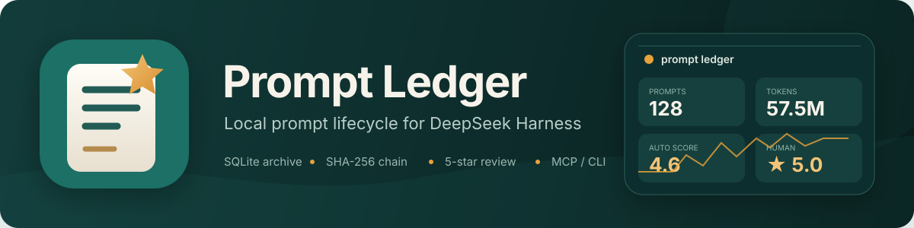
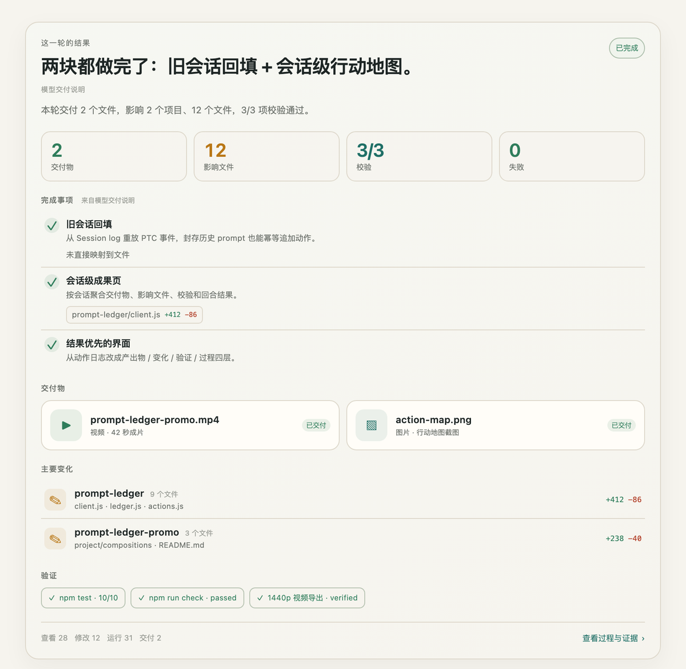
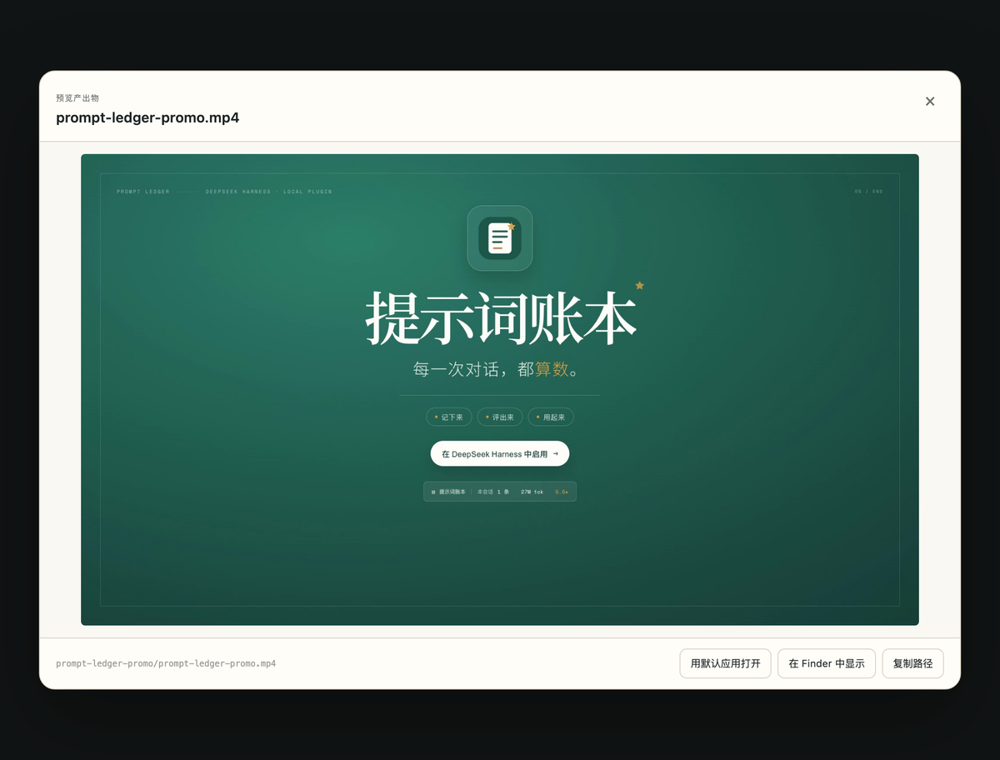
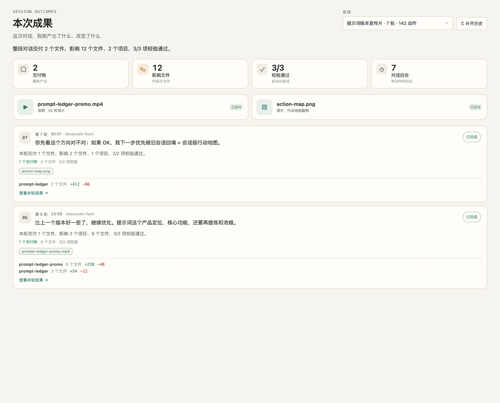

# 提示词账本 · Prompt Ledger

[](LICENSE)


一个装在 DeepSeek Harness 左侧栏里的**本地提示词全生命周期账本**：每次提交自动归档提示词、模型、Token、工具、Skill、MCP 调用和回合结果，提供五星人工评分、规则/模型双评、SQLite 不可变审计链、多维交叉分析、筛选导出，以及面向 ChatGPT、Codex、Work Buddy、豆包工作版、TRAE 的适配器。

插件 id：`prompt-ledger` · 包名：`@local/prompt-ledger` · 左侧栏 key：`prompt-ledger` · 数据库：`~/.dsh/prompt-ledger/prompt-ledger.sqlite3`

## 1.2.0 介绍片

[▶ 观看 42 秒产品介绍片](https://github.com/redogcc/prompt-ledger/releases/download/v1.2.0/prompt-ledger-1.2.0-promo.mp4)


完整变更见 [1.2.0 Release Notes](RELEASE_NOTES-1.2.0.md)。视频围绕「结果卡 → 产出物预览 → 完成事项证据 → 会话成果」讲这一版新增的能力。

---

## 1. 它解决什么

| 需求 | 实现 |
| --- | --- |
| 每次提交自动采集 | DSH Host 监听 `session/event`，从持久会话日志提取 `user/message`、`turn/start`、`assistant/message`、`tool/call`、`tool/result`、`turn/end`，不要求用户改工作流 |
| 完整全链路元数据 | 提示词原文、平台、会话、模型/Provider、输入/输出/缓存/推理 Token、耗时、工具调用与错误、Skill、MCP、最终回答、结束原因 |
| 五星效果评分 | 列表内联五星 + 详情页评分/备注，评分是新追加的 annotation，不修改原提示词 |
| SQLite 本地存档 | Node 内置 `node:sqlite`，WAL 模式，零外部依赖；所有数据只在本机 |
| 忠实、不可篡改 | 提示词封存后触发器禁止 UPDATE/DELETE；事件、提交、评分、评估、评估体系全部 append-only；全局 SHA-256 链 + 封存快照校验 |
| 可视化报表 | 总览 KPI/趋势/模型/工具、提示词库、模型/工具/Skill/MCP 交叉分析、评分分布、双评校准 |
| 对话侧边统计 | 输入框上方左侧的「提示词账本」状态行：本会话条数、Token、人工均分；点击展开会话速览卡（用量与缓存、工具、双评、审计链），可点击下钻；每个完成回合尾部一条轻量账本行 |
| 标准化评估体系 | 默认 5 维（结果、质量、工具、Token、速度），权重可调、维度可增删，自动按权重归一化 |
| 多维筛选导出 | 时间、平台、模型、工具、最低评分、关键词、排序；CSV/JSON 导出 |
| 双向评估闭环 | 本地规则自动评分（默认开）+ 模型评审（显式开启，使用当轮模型，额外 Token 成本）；人工五星另行追加 |
| 跨平台 | 统一 SQLite + 统一 JSON 契约；DSH 原生、MCP 服务、CLI、ChatGPT Action、Codex 会话同步、TRAE MCP、Work Buddy/豆包 Skill |
| 轻量无侵入 | 不修改提示词/消息、不拦截模型请求、不注入 system prompt、不重写会话日志；仅旁路监听和本地读写 |

### 这一轮的结果：先看产出，再看过程





普通用户不需要读工具 JSON。每个回合的结果卡按“结果 → 影响 → 验证 → 过程”排列：

- **结果标题**：优先显示模型最后一段交付说明，下面用事实句补全：产出几个文件、影响几个项目、几项校验通过。
- **完成事项**：从交付说明的二级标题提取 2–4 项（如“存档 / 数据约束 / 开源件实测”），每项配一句摘要，并尝试从标题/正文中的文件链接映射到具体文件 chip；没有直接证据时明确标“未直接映射到文件”。这是模型视角，下面的数字与文件是可核实事实。
- **四个指标**：交付物、影响文件、校验通过、失败动作，一眼看到这一轮到底有没有产出。
- **产出物**：present 明确交付的文件标为「已交付」；write 新建的文档 / 代码 / 素材也会进入产出物，标为「已产出」。点击卡片可直接预览：图片 / 视频 / PDF / 文本；也可用默认应用打开、在 Finder 中显示、复制路径。
- **主要变化**：按项目聚合改动文件，显示 +新增 / −删除，不再铺 20 多个文件路径。
- **验证**：把 npm test、npm run check 等自动化校验单独列出，失败标红；没有校验时明确写“没有运行自动化校验”。
- **过程与证据**：默认收起；需要核实的人再展开完整动作时间线、命令、diff 和调用 ID。

#### 数据来源

| 来源事件 | 用途 |
| --- | --- |
| `tool/call` / `tool/result` | 直接工具调用与结果 |
| `tool/ptc-dispatch-start` | `run_code` 内部真正执行的工具名与参数（读、写、改、命令、MCP…） |
| `tool/ptc-dispatch` | 嵌套工具的结果、错误与耗时 |
| `present` | 最终交付的文件 |

写入 `action_events` 表前会做三件事：**裁剪过长内容、脱敏常见密钥、只保留可核实的摘要**。命令、改动前后、结果都放在「查看依据」里，默认不展开。

### 成果地图：整段对话的产出与变化



单轮详情回答“这一轮产出了什么”，成果地图回答“整段对话到底交付了什么、改变了什么”：

- 顶部选择会话，默认选中最近有动作的会话。
- 四个成果卡：**交付物 / 影响文件 / 校验通过 / 对话回合**。
- 产出物画廊：整段会话产出的视频、图片、文档、代码文件；present 与新建文件都会进入。
- 按回合排列：每轮显示用户意图、结果事实句、交付物、项目级改动 +新增 / −删除；不再铺原始动作日志。
- 点“查看本轮结果”回到详情页看完整证据。
- 历史会话：点右上角 **「补齐历史」**，从 durable Session log 重建行动轨迹；重复点击只跳过已存在的动作。

#### 边界

- **bash 产出的文件不冒充文件操作**：命令会显示为「运行命令」，不会把命令里猜测的路径当成已修改文件；明确由 read / write / edit / present 产生的文件才会进入「涉及文件」。
- **旧记录按需补齐**：新回合实时采集；历史会话在「成果」页点「补齐历史」，从会话日志重放并幂等写入，不会改提示词正文。
- **宿主需要重载**：Host 端新增了事件监听，安装/更新插件后需要重启 DSH（或重载插件），刷新页面只更新面板样式。
- 如果打开「成果」页看到 **「成果页需要重启 DSH」**，说明前端已更新、Host 仍是旧进程；完全退出 DSH 再打开，然后点「重新检测」。

---

## 2. 安装与快速开始

### 从 GitHub 安装

要求：Node.js **22.5+**（使用内置 `node:sqlite`），DeepSeek Harness 0.2.x。插件没有运行时 npm 依赖。

```bash
git clone https://github.com/redogcc/prompt-ledger.git
cd prompt-ledger
npm test
npm run check
```

然后在 DSH 中让 Agent 调用：

```text
plugin_manager install_bundle
target=/absolute/path/to/prompt-ledger
```

这是 DSH 当前支持的本地 bundle 安装方式；不要把插件目录手动复制进 profile，也不要直接编辑 profile 的 `package.json` / `cordis.patch.yml`。安装成功后刷新页面。

### 从 Release 安装

```bash
unzip prompt-ledger-1.2.0.zip
```

把解压后的目录绝对路径交给同一个 `install_bundle`。Release 同时提供 `.sha256` 校验文件。

### 安装后怎么用

1. **刷新一次 DSH 页面**（插件安装时已打开页面的话），左侧栏出现「提示词账本」图标（书页 + 星标）。
2. 点击进入主面板。新会话提交第一条提示词后，总览会自动出现数据。
3. **输入框上方左侧**是一条与输入框同宽的「提示词账本」状态行：`提示词账本 | 本会话 1 条 · 27M tok · 5.0★`。首次有数据时图标上会出现一个小圆点提示，不会再自动弹卡；点击展开会话速览卡，点击外部、Esc 或再次点状态行收起。卡片以本会话 Token 为主视觉（含缓存命中），下排是提示词数、工具/Skill/MCP、自动评分，底部是人工五星与审计链状态；点任一块会打开主面板的对应页面。
4. **每个完成的回合后面**会出现一条轻量账本行：状态、模型、工具数、自动评分、五星评分与「查看复盘」。Token 只在会话状态行和复盘详情里出现，避免和消息自身的用量重复。点「查看复盘」会直接打开主面板并定位到该条提示词。
5. 在任意提示词行点星评分；点开详情可写复盘备注、加标签、收藏、查看工具调用、自动评分与审计链。
6. 「效果分析」按模型/工具/Skill/MCP 交叉比较；「接入与设置」可配置评估维度、自动评分、模型评审、完整性校验和跨平台写入端点。

数据路径：`~/.dsh/prompt-ledger/prompt-ledger.sqlite3`。可用环境变量 `PROMPT_LEDGER_DB` 覆盖。

---

## 3. 架构

```
DSH session log ──(session/event, 旁路)──┐
                                        ▼
ChatGPT Action ─┐                  ┌──────────────┐
Codex MCP/同步 ─┤                  │ Prompt Ledger│
Work Buddy MCP ─┼── 统一 JSON ───▶│  Host plugin │──▶ SQLite (WAL)
Doubao MCP ─────┤                  │  + ledger.js │      ├─ prompts
TRAE MCP ───────┤                  └──────┬───────┘      ├─ submissions
CLI / HTTP ─────┘                         │              ├─ tool_invocations
                                          │              ├─ annotations
                                    Web panel ◀──────────┤ ├─ evaluations
                                    (left sidebar)       │ ├─ rubrics
                                                         │ └─ prompt_events (hash chain)
                                                         └─ integrity()
```

- **Host**：`index.js` 监听会话事件、写库、注册 HTTP API 与 `prompt_ledger` Agent 工具；可选 `webServer` 本地写入端点。
- **Storage**：`ledger.js` 无第三方依赖，DSH / CLI / MCP 共用；SQLite schema、触发器、评分、聚合、CSV 都在这里。
- **Client**：`client.js` 纯 JS React，注册 `sidebar.panellist` 和 `main`，无构建步骤、无 iframe、无打包复制 React。
- **Adapters**：`adapters/` 下 MCP server、CLI、ChatGPT Action/导入器、Codex 同步器；`skills/prompt-ledger/SKILL.md` 是跨平台 Skill。

---

## 4. 数据模型与“不可篡改”

### 表

| 表 | 写入方式 | 说明 |
| --- | --- | --- |
| `prompts` | 采集期可更新，`turn/end` 后封存 | 一行一个回合；封存后触发器拒绝所有 UPDATE/DELETE |
| `prompt_submissions` | 只追加 | 每次用户提交（含同一回合的 steering）单独一行 |
| `tool_invocations` | 采集期可更新 | 工具/Skill/MCP 调用、参数哈希、结果摘要、错误 |
| `prompt_events` | 只追加 | 全局 SHA-256 链：`hash = sha256(prev + kind + prompt + time + payload)` |
| `prompt_annotations` | 只追加 | 五星评分、备注、标签、收藏；最新一条为当前值 |
| `prompt_evaluations` | 只追加 | `auto_rule` / `auto_model` 评分与维度明细 |
| `rubrics` | 只追加新版本 | 评估维度与权重，历史版本保留 |
| `settings` | 可更新 | 自动评分开关、模型评审开关、回填开关、本地写入 token |

### 防篡改边界

- 触发器阻止应用层和普通 SQL 的 UPDATE/DELETE；删除数据库文件本身无法被 SQLite 阻止。
- `prompt_events` 链 + 封存快照 `row_hash` 使**篡改可检测**：`integrity()` 重算链和每条封存快照，返回具体 issue。
- 这不是硬件级 WORM，也不是数字签名；如果攻击者拥有文件系统 root 权限并重写整库，仍可能伪造一致链。对桌面本地存档，这已是轻量方案的上限。
- 提示词内容在封存后不可修改；评分/标签/备注是**追加**的新版本，不会覆盖原始记录。

---

## 5. 评估体系

默认维度：

| id | 中文 | 权重 | 自动规则 |
| --- | --- | --- | --- |
| `outcome` | 结果完成度 | 30% | completed=5，interrupted=3，aborted=2，failed=1 |
| `quality` | 回答质量 | 25% | 最终回答长度、是否存在、工具错误惩罚 |
| `tool` | 工具效率 | 20% | 调用成功/失败比例；无工具调用给中性 4 |
| `tokens` | Token 效率 | 15% | 总 Token 分档 1–5 |
| `speed` | 响应速度 | 10% | 端到端耗时 1–5 |

- 权重保存时自动归一化，维度可增删（至少 3 个）。新增维度的规则分默认 3；如需自定义算法，扩展 `ledger.js` 的 `evaluateRule()`。
- **人工评分**：1–5 星 + 备注，只在用户点击时写入。
- **规则自动评分**：回合封存后立即计算，不调用模型、不产生额外 Token。
- **模型评审**：在「接入与设置」显式开启；使用当轮 Provider/Model 再调用一次模型，返回各维度 1–5 和简短观察。失败不影响会话，也不覆盖规则评分；两条评估都会保留。
- **校准**：分析页按自动分桶展示人工均分，偏差越小说明规则/模型评审越接近人的判断。

---

## 6. 跨平台适配

| 平台 | 方式 | 自动程度 | 文件 |
| --- | --- | --- | --- |
| DeepSeek Harness | 原生 Host 监听 | 全自动，无需配置 | `index.js` |
| ChatGPT | 自定义 GPT Action（实时）或导出导入（回填） | Action 需 HTTPS 隧道 + token；导入为手动 | `adapters/chatgpt/` |
| Codex | MCP `log_turn` + `~/.codex/sessions` 同步 | MCP 由 Skill 触发；同步可定时 | `adapters/codex/` |
| Work Buddy | Skill + 本地 MCP | Skill 触发 | `adapters/workbuddy/` |
| 豆包工作版 | Skill + 本地 MCP | Skill 触发 | `adapters/doubao/` |
| TRAE | 原生 MCP | Skill 触发 | `adapters/trae/` |
| 通用 | CLI / HTTP / MCP | 手动或自建 hook | `adapters/cli.mjs`、`adapters/post.mjs` |

**一致性边界**：各平台的采集入口不同，但写入同一个 SQLite、使用同一套 schema、评分、评估与报表。托管型 ChatGPT/Work Buddy/豆包如果无法运行本地 MCP，必须通过可访问的本地 HTTP 桥或导出文件；这是平台限制，不是账本侧的分叉。

### MCP 配置模板

```json
{
  "mcpServers": {
    "prompt-ledger": {
      "command": "node",
      "args": ["/ABSOLUTE/PATH/TO/prompt-ledger/adapters/mcp-server.mjs"],
      "env": { "PROMPT_LEDGER_DB": "/Users/YOU/.dsh/prompt-ledger/prompt-ledger.sqlite3" }
    }
  }
}
```

MCP 工具：`log_turn`、`rate_turn`、`search_turns`、`get_turn`、`stats`、`integrity`、`export`。`rate_turn` 明确要求只在用户给出评分时调用。

### 本地 HTTP 写入

DSH 面板「接入与设置」会显示 `http://127.0.0.1:<port>/prompt-ledger/v1/ingest` 和 token。示例：

```bash
node adapters/post.mjs \
  --url http://127.0.0.1:62086/prompt-ledger/v1/ingest \
  --token <token> --file turn.json
```

### CLI

```bash
node adapters/cli.mjs stats --range 30d
node adapters/cli.mjs list --q 插件 --limit 20 --json
node adapters/cli.mjs get --id <prompt-id>
node adapters/cli.mjs rate --id <prompt-id> --stars 5 --note "结构清楚"
node adapters/cli.mjs export --out prompt-ledger.csv
node adapters/cli.mjs integrity
```

### ChatGPT 导入

```bash
node adapters/chatgpt/import.mjs conversations.json
```

### Codex 会话同步

```bash
node adapters/codex/sync.mjs
node adapters/codex/sync.mjs --dry-run
```

---

## 7. 本地 API 与 Agent 工具

浏览器面板通过 Host 的认证 Fetch 路由访问：

`bootstrap`、`overview`、`prompts`、`prompt`、`rate`、`annotate`、`analytics`、`facets`、`settings`、`rubric`、`integrity`、`export`、`ingest`。

Agent 工具 `prompt_ledger` 提供 `overview` / `search` / `get` / `analytics` / `integrity`。**评分与备注不开放给 Agent 工具**，避免模型替用户打分。

外部写入端点独立于认证路由，使用 `x-prompt-ledger-token`，只绑定一个 `POST` 路径和健康检查；token 由插件本地生成，可在面板重查。若暴露到公网，请只用你自己的 HTTPS 隧道，并定期更换 token/删除数据库重建。

---

## 8. 隐私与安全

- 默认不联网：所有采集、评分、统计、导出均本地完成。
- 模型评审是**唯一**会把当轮文本发给模型提供商的路径，默认关闭，需手动开启，并明确提示额外 Token 成本。
- 外部写入端点只在 Host Web 服务监听地址上提供；token 不写日志。
- SQLite 文件权限由操作系统用户控制；不要把 `.dsh/prompt-ledger` 放进公开仓库或共享目录。
- `integrity()` 可发现链断裂、封存快照被改、缺失封存事件和 SQLite 外键问题；发现异常时面板显示具体 issue。

---

## 9. 开发与文件

```
prompt-ledger/
├── package.json          # bundle + client manifest
├── cordis.patch.yml      # insert id: prompt-ledger
├── index.js              # Host: capture, HTTP, tool, model judge
├── ledger.js             # SQLite engine: schema, hash chain, analytics, CSV
├── client.js             # Web: sidebar + 4-tab panel
├── locale/{zh,en}.json   # Plugin Manager metadata
├── icon.svg              # 原创书页+星标图标
├── adapters/
│   ├── mcp-server.mjs
│   ├── cli.mjs
│   ├── post.mjs
│   ├── chatgpt/{openapi.yaml,instructions.md,import.mjs}
│   ├── codex/{README.md,sync.mjs}
│   ├── trae/{README.md,mcp.json}
│   ├── workbuddy/README.md
│   └── doubao/README.md
├── skills/prompt-ledger/SKILL.md
├── docs/banner.svg       # README 品牌图
├── test/                 # node:test 测试
├── scripts/              # check + release 打包
├── .github/workflows/    # CI
├── LICENSE               # MIT
├── CHANGELOG.md
├── CONTRIBUTING.md
├── SECURITY.md
└── README.md
```

开发检查：

```bash
npm test        # SQLite、hash chain、触发器、导入、client slot 注册
npm run check   # 语法、manifest、locale、icon、敏感路径、打包卫生
npm run pack:release
```

`npm run pack:release` 会生成 `dist/prompt-ledger-<version>.zip` 和对应的 SHA-256 校验文件。

---

## 10. 已验证 / 未验证

已验证：

- `plugin_manager install_bundle` 返回 `application: applied`、`warnings: []`。
- `sidebar.panellist` 出现 `prompt-ledger`（order 19，active），`main` 出现 `prompt-ledger` key（active）。
- 真实 DSH 会话回填与 1000+ 事件；工具错误从真实 `tool/result` 推导，不再把正常结果误判为错误。
- 本地写入端点健康检查 200；错误 token 返回 401；POST 路由已改为可写 handler（之前误用只读 resource 会 405）。
- `prompt_ledger` 工具 `overview` / `search` / `analytics` / `integrity` 均返回合法 lossless JSON；`integrity.ok = true`。
- SQLite 触发器实测：封存提示词 UPDATE/DELETE、事件 UPDATE/DELETE 均被拒绝。
- `node:test` 覆盖 ledger、hash chain、触发器、外部导入和 client slot 注册；React test renderer 跑通四个 tab、提示词详情、五星点击、折叠/展开胶囊、会话速览卡与回合尾部行。
- CLI、MCP、ChatGPT 导入器、Codex 同步器分别用合成数据跑通；MCP `log_turn` 返回正确 id 与自动分。

未验证：

- **真实浏览器视觉**：开发环境没有浏览器控制，未截图；请在 DSH 页面刷新后目视检查明暗主题。折叠胶囊/回合行已按宿主的字号、图标、分隔与浮层层级重做，但最终像素效果仍需人眼确认。
- **第三方平台真实安装**：ChatGPT / Codex / Work Buddy / 豆包 / TRAE 不在本机运行，适配器与安装文档已交付，但未在那些客户端内实际添加 MCP/Action。
- **真实模型评审**：用 fake `llm.stream` 验证了解析/写库/双评并存；未在真实模型上额外消耗 Token 验证。
- **长时间大规模性能**：当前库 700+ 事件正常；十万级事件需要再做批量写入/归档策略。


---

## 11. License & links

- License: [MIT](LICENSE)
- Contributing: [CONTRIBUTING.md](CONTRIBUTING.md)
- Security and privacy: [SECURITY.md](SECURITY.md)
- Changelog: [CHANGELOG.md](CHANGELOG.md)
- Publishing checklist: [docs/PUBLISHING.md](docs/PUBLISHING.md)

`Prompt Ledger` 是独立社区项目，与 DeepSeek 官方无隶属关系。DeepSeek Harness、ChatGPT、Codex、TRAE、Work Buddy、豆包等名称归各自权利人所有。
